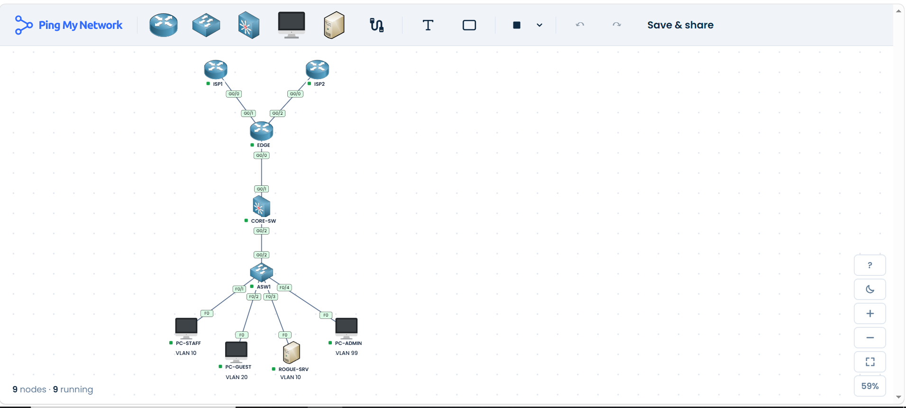

[**PingMyNetwork Sandbox Challenge**](https://pingmynetwork.com/event/sandbox-challenge)

# Resilient Branch Edge: Dual-ISP Failover, PAT, Guest ACL & Layer 2 Hardening (CCNA)

> **Level:** CCNA 200-301 | **Time:** 60-90 min | **Platform:** PingMyNetwork Sandbox
> **Topics:** OSPF default-route origination, floating static routes, PAT on a shared loopback address, extended ACL, DHCP snooping, Dynamic ARP Inspection (DAI), port security, SSH, break & fix troubleshooting



---

## 1. Scenario

A small branch office has one edge router connected to **two ISPs**. Staff, Guests and Admins each have their own VLAN. Management asked for:

1. The Internet must keep working if the primary ISP link fails.
2. All internal users share one public address (PAT).
3. Guests may reach the Internet but never the Staff or Management networks.
4. A rogue DHCP server or an ARP spoofer plugged into a wall port must not be able to hijack users.
5. Switches are managed only over SSH from the Management VLAN.

You will configure the network, verify it, then break it and fix it.

---

## 2. Topology

```
                  Lo0 203.0.113.10/32 ("Internet server", same address on both ISPs)
          +--------------+                       +--------------+
          |     ISP1     |                       |     ISP2     |
          +------+-------+                       +-------+------+
            Gi0/0 | 198.51.100.1/30              192.0.2.1/30 | Gi0/0
                  |                                           |
            Gi0/1 | 198.51.100.2/30              192.0.2.2/30 | Gi0/2
              +---+-------------------------------------------+---+
              |                       EDGE                        |
              |   Lo0 198.18.0.1/32 (PAT address)                 |
              +---------------------------+-----------------------+
                                    Gi0/0 | 10.0.0.1/30
                                          |
                                    Gi0/1 | 10.0.0.2/30
              +---------------------------+-----------------------+
              |            CORE-SW (Layer 3 switch)               |
              |  SVIs, DHCP server, OSPF, Guest ACL               |
              +---------------------------+-----------------------+
                                    Gi0/2 | trunk (VLAN 10, 20, 99)
                                    Gi0/2 |
              +---------------------------+-----------------------+
              |            ASW1 (access switch)                   |
              |  DHCP snooping, DAI, port security, SSH           |
              +----+------------+------------+------------+-------+
              Fa0/1|       Fa0/2|       Fa0/3|       Fa0/4|
               PC-STAFF     PC-GUEST     ROGUE-SRV     PC-ADMIN
               VLAN 10      VLAN 20      VLAN 10       VLAN 99
```

### Cabling

| From | To |
|:--|:--|
| EDGE Gi0/0 | CORE-SW Gi0/1 |
| EDGE Gi0/1 | ISP1 Gi0/0 (primary) |
| EDGE Gi0/2 | ISP2 Gi0/0 (backup) |
| CORE-SW Gi0/2 | ASW1 Gi0/2 (trunk) |
| ASW1 Fa0/1 | PC-STAFF |
| ASW1 Fa0/2 | PC-GUEST |
| ASW1 Fa0/3 | ROGUE-SRV |
| ASW1 Fa0/4 | PC-ADMIN |

---

## 3. Addressing & VLAN Tables

| Device | Interface | IP Address | Mask | Role |
|:--|:--|:--|:--|:--|
| ISP1 | Gi0/0 | 198.51.100.1 | /30 | Link to EDGE (primary) |
| ISP1 | Lo0 | 203.0.113.10 | /32 | Simulated Internet server |
| ISP2 | Gi0/0 | 192.0.2.1 | /30 | Link to EDGE (backup) |
| ISP2 | Lo0 | 203.0.113.10 | /32 | Simulated Internet server |
| EDGE | Gi0/0 | 10.0.0.1 | /30 | Inside (NAT inside) |
| EDGE | Gi0/1 | 198.51.100.2 | /30 | ISP1 (NAT outside) |
| EDGE | Gi0/2 | 192.0.2.2 | /30 | ISP2 (NAT outside) |
| EDGE | Lo0 | 198.18.0.1 | /32 | PAT address (NAT outside) |
| CORE-SW | Gi0/1 | 10.0.0.2 | /30 | Routed port to EDGE |
| CORE-SW | Vlan10 | 192.168.10.1 | /24 | Staff gateway |
| CORE-SW | Vlan20 | 192.168.20.1 | /24 | Guest gateway |
| CORE-SW | Vlan99 | 192.168.99.1 | /24 | Management gateway |
| ASW1 | Vlan99 | 192.168.99.2 | /24 | Switch management (gateway 192.168.99.1) |
| PC-STAFF | NIC | DHCP | /24 | VLAN 10 |
| PC-GUEST | NIC | DHCP | /24 | VLAN 20 |
| PC-ADMIN | NIC | 192.168.99.10 (static) | /24 | VLAN 99, gateway 192.168.99.1 |
| ROGUE-SRV | NIC | static address in VLAN 10 | /24 | Runs a fake DHCP service (pool 192.168.10.0/24, gateway 192.168.10.254) |

| VLAN | Name | Subnet |
|:--|:--|:--|
| 10 | STAFF | 192.168.10.0/24 |
| 20 | GUEST | 192.168.20.0/24 |
| 99 | MGMT | 192.168.99.0/24 |

---

## 4. Sandbox Notes (read before you build)

- **PAT uses a loopback address.** This Sandbox does not accept `ip nat inside source route-map ...`. All internal traffic is translated to `Loopback0` (198.18.0.1) on EDGE, and both ISPs have a return route to that address.
- **ASW1 trunk:** the access switch supports only 802.1Q, so the command `switchport trunk encapsulation dot1q` does not exist there. Leave it out on ASW1.
- **DHCP snooping:** `show ip dhcp snooping statistics` is not available. Use `show ip dhcp snooping binding` and `show logging` instead.
- **Failover is very fast.** A continuous ping may not drop a single packet. Prove the switchover with `show ip route static` instead.

---

## 5. Device Configurations

### ISP1
```
enable
configure terminal
hostname ISP1
interface Loopback0
 description SIMULATED_INTERNET_SERVER
 ip address 203.0.113.10 255.255.255.255
interface GigabitEthernet0/0
 description TO_EDGE_PRIMARY
 ip address 198.51.100.1 255.255.255.252
 no shutdown
ip route 198.18.0.1 255.255.255.255 198.51.100.2
end
write memory
```

### ISP2
```
enable
configure terminal
hostname ISP2
interface Loopback0
 description SIMULATED_INTERNET_SERVER
 ip address 203.0.113.10 255.255.255.255
interface GigabitEthernet0/0
 description TO_EDGE_BACKUP
 ip address 192.0.2.1 255.255.255.252
 no shutdown
ip route 198.18.0.1 255.255.255.255 192.0.2.2
end
write memory
```

### EDGE
```
enable
configure terminal
hostname EDGE

interface Loopback0
 description PAT_ADDRESS
 ip address 198.18.0.1 255.255.255.255
 ip nat outside
interface GigabitEthernet0/0
 description TO_CORE-SW
 ip address 10.0.0.1 255.255.255.252
 ip nat inside
 no shutdown
interface GigabitEthernet0/1
 description TO_ISP1_PRIMARY
 ip address 198.51.100.2 255.255.255.252
 ip nat outside
 no shutdown
interface GigabitEthernet0/2
 description TO_ISP2_BACKUP
 ip address 192.0.2.2 255.255.255.252
 ip nat outside
 no shutdown

! Primary default route and floating backup (administrative distance 250)
ip route 0.0.0.0 0.0.0.0 198.51.100.1
ip route 0.0.0.0 0.0.0.0 192.0.2.1 250

! OSPF: learn the internal VLANs and advertise the default route to CORE-SW
router ospf 1
 router-id 1.1.1.1
 network 10.0.0.0 0.0.0.3 area 0
 default-information originate

! PAT for all internal subnets
ip access-list standard NAT_INSIDE
 permit 192.168.10.0 0.0.0.255
 permit 192.168.20.0 0.0.0.255
 permit 192.168.99.0 0.0.0.255
ip nat inside source list NAT_INSIDE interface Loopback0 overload
end
write memory
```

### CORE-SW (Layer 3 switch)
```
enable
configure terminal
hostname CORE-SW
ip routing

vlan 10
 name STAFF
vlan 20
 name GUEST
vlan 99
 name MGMT
exit

interface GigabitEthernet0/1
 description TO_EDGE
 no switchport
 ip address 10.0.0.2 255.255.255.252
 no shutdown
interface GigabitEthernet0/2
 description TRUNK_TO_ASW1
 switchport trunk encapsulation dot1q
 switchport mode trunk
 switchport trunk allowed vlan 10,20,99
 no shutdown

interface Vlan10
 description STAFF_GATEWAY
 ip address 192.168.10.1 255.255.255.0
 no shutdown
interface Vlan20
 description GUEST_GATEWAY
 ip address 192.168.20.1 255.255.255.0
 ip access-group GUEST_IN in
 no shutdown
interface Vlan99
 description MGMT_GATEWAY
 ip address 192.168.99.1 255.255.255.0
 no shutdown

ip dhcp excluded-address 192.168.10.1 192.168.10.20
ip dhcp excluded-address 192.168.20.1 192.168.20.20
ip dhcp pool STAFF_POOL
 network 192.168.10.0 255.255.255.0
 default-router 192.168.10.1
 dns-server 203.0.113.10
ip dhcp pool GUEST_POOL
 network 192.168.20.0 255.255.255.0
 default-router 192.168.20.1
 dns-server 203.0.113.10

router ospf 1
 router-id 2.2.2.2
 passive-interface Vlan10
 passive-interface Vlan20
 passive-interface Vlan99
 network 10.0.0.0 0.0.0.3 area 0
 network 192.168.10.0 0.0.0.255 area 0
 network 192.168.20.0 0.0.0.255 area 0
 network 192.168.99.0 0.0.0.255 area 0

! Guests: DHCP and Internet only. No access to Staff or Management.
ip access-list extended GUEST_IN
 permit udp any eq bootpc any eq bootps
 deny   ip 192.168.20.0 0.0.0.255 192.168.10.0 0.0.0.255
 deny   ip 192.168.20.0 0.0.0.255 192.168.99.0 0.0.0.255
 permit ip 192.168.20.0 0.0.0.255 any
end
write memory
```

### ASW1 (access switch)
```
enable
configure terminal
hostname ASW1

vlan 10
 name STAFF
vlan 20
 name GUEST
vlan 99
 name MGMT
exit

! Uplink to CORE-SW: trusted for DHCP snooping and DAI
interface GigabitEthernet0/2
 description TRUNK_TO_CORE-SW
 switchport mode trunk
 switchport trunk allowed vlan 10,20,99
 ip dhcp snooping trust
 ip arp inspection trust
 no shutdown

! Access ports
interface FastEthernet0/1
 description PC-STAFF
 switchport mode access
 switchport access vlan 10
 spanning-tree portfast
 spanning-tree bpduguard enable
 switchport port-security
 switchport port-security maximum 1
 switchport port-security mac-address sticky
 switchport port-security violation restrict
 ip dhcp snooping limit rate 15
interface FastEthernet0/2
 description PC-GUEST
 switchport mode access
 switchport access vlan 20
 spanning-tree portfast
 spanning-tree bpduguard enable
 switchport port-security
 switchport port-security maximum 1
 switchport port-security mac-address sticky
 switchport port-security violation restrict
 ip dhcp snooping limit rate 15
interface FastEthernet0/3
 description ROGUE-SRV
 switchport mode access
 switchport access vlan 10
 spanning-tree portfast
 spanning-tree bpduguard enable
interface FastEthernet0/4
 description PC-ADMIN
 switchport mode access
 switchport access vlan 99
 spanning-tree portfast
 spanning-tree bpduguard enable

! Shut down unused ports
interface range FastEthernet0/5 - 24
 shutdown
interface GigabitEthernet0/1
 description UNUSED
 shutdown
exit

! DHCP snooping and DAI on the user VLANs
ip dhcp snooping
ip dhcp snooping vlan 10,20
no ip dhcp snooping information option
ip arp inspection vlan 10,20

! Management and SSH (lab-only credentials)
interface Vlan99
 ip address 192.168.99.2 255.255.255.0
 no shutdown
ip default-gateway 192.168.99.1
ip domain-name branch.lab
username admin secret Sandbox#2026
crypto key generate rsa modulus 2048
ip ssh version 2
line vty 0 4
 login local
 transport input ssh
end
write memory
```
> **Why `no ip dhcp snooping information option`?** With snooping on, the switch inserts DHCP Option 82. The IOS DHCP server on CORE-SW ignores such requests, so clients would never get a lease.

---

## 6. Verification Tasks (with expected results)

| # | Task | Command / Action | Expected result |
|:--|:--|:--|:--|
| 1 | VLANs and trunk | ASW1: `show vlan brief`, `show interfaces trunk` | VLANs 10, 20, 99 exist; Gi0/2 is trunking and allows 10, 20, 99 |
| 2 | DHCP leases | PC-STAFF and PC-GUEST: `ipconfig` | Staff gets 192.168.10.x with gateway .1; Guest gets 192.168.20.x with gateway .1 |
| 3 | Snooping bindings | ASW1: `show ip dhcp snooping binding` | One entry per PC: VLAN 10 on Fa0/1 and VLAN 20 on Fa0/2 |
| 4 | OSPF | EDGE: `show ip ospf neighbor`; CORE-SW: `show ip route` | Neighbor FULL; CORE-SW has `O*E2 0.0.0.0/0` via 10.0.0.1 |
| 5 | Internet and PAT | PC-STAFF: `ping 203.0.113.10`, `tracert 203.0.113.10`; EDGE: `show ip nat translations` while the ping runs | Replies OK; path is 192.168.10.1, 10.0.0.1, then 203.0.113.10; inside global address is **198.18.0.1** |
| 6 | Guest isolation | PC-GUEST: ping a Staff PC, ping 192.168.99.2, ping 203.0.113.10; CORE-SW: `show access-lists GUEST_IN` | First two fail, Internet works; the deny lines show match counts |
| 7 | Failover | PC-STAFF: `ping -t 203.0.113.10`; EDGE: shut `Gi0/1`, then `clear ip nat translation *`, then `show ip route static` | Pings continue (zero or very few lost); the default route is now **via 192.0.2.1 [250/0]** |
| 8 | Failback | EDGE: `no shutdown` on Gi0/1, then `clear ip nat translation *` | Default route returns to **via 198.51.100.1 [1/0]** |
| 9 | Rogue DHCP | Turn on DHCP on ROGUE-SRV; PC-STAFF: `ipconfig /release`, `ipconfig /renew`; ASW1: `show logging` | PC-STAFF keeps gateway **192.168.10.1** (never .254); the log shows `DHCPOFFER` dropped on **Fa0/3** |
| 10 | DAI | Set PC-STAFF to static 192.168.10.50 and ping 192.168.10.1; ASW1: `show ip arp inspection statistics vlan 10` | Ping fails; dropped ARP count rises. Set PC-STAFF back to DHCP |
| 11 | Port security | Move PC-GUEST's cable to Fa0/1; ASW1: `show port-security interface fa0/1` | Violation count rises (restrict mode); the original PC keeps working after you restore the cable |
| 12 | SSH | PC-ADMIN: `ssh -l admin 192.168.99.2` | Login succeeds; PC-GUEST cannot reach 192.168.99.2 |

Example evidence from the finished lab:

```
ASW1#show ip dhcp snooping binding
MacAddress          IpAddress        Lease(sec)  Type           VLAN  Interface
40:35:33:83:39:61   192.168.10.21    86349       dhcp-snooping  10    Fa0/1
56:49:47:28:46:70   192.168.20.21    86361       dhcp-snooping  20    Fa0/2

EDGE#show ip nat translations
Pro  Inside global     Inside local       Outside local      Outside global
icmp 198.18.0.1:1057   192.168.10.21:1057 203.0.113.10:1057  203.0.113.10:1057
```

---

## 7. Break & Fix Challenge

These faults were all hit while building the lab. Apply one at a time. Learners must find the cause using `show` commands only.

| # | Injected fault | Symptom | Where to look | Fix |
|:--|:--|:--|:--|:--|
| A | On EDGE remove `ip nat inside` from Gi0/0 and `ip nat outside` from the outside interfaces | PCs cannot reach 203.0.113.10; NAT shows zero translations | `show ip nat statistics`, `show running-config \| section nat` | Restore inside on Gi0/0 and outside on Gi0/1, Gi0/2, Lo0 |
| B | On ASW1 enable DAI (`ip arp inspection vlan 10,20`) while DHCP snooping is off | PCs have a valid lease but cannot ping their own gateway | ASW1 `show logging` shows `Invalid ARPs` on Fa0/1 | Enable DHCP snooping first so the binding table exists, then DAI |
| C | On ASW1 trust the wrong port (for example Gi0/1) for DHCP snooping | No DHCP leases (169.254.x.x) | ASW1 `show logging` shows `DHCPOFFER` dropped on **Gi0/2**; `show ip dhcp snooping` | `ip dhcp snooping trust` on the real uplink Gi0/2 |
| D | On ISP1 remove `ip route 198.18.0.1 255.255.255.255 198.51.100.2` | EDGE can ping the ISP link but the PAT address gets no replies | ISP1 `show ip route 198.18.0.1` | Restore the return route |
| E | On EDGE shut down Gi0/1 and leave it down | Traffic silently uses ISP2; `show ip route static` shows the AD 250 route | EDGE `show ip route static`, `show ip interface brief` | `no shutdown` on Gi0/1 |

---

## 8. Common Mistakes

- Forgetting `ip routing` on CORE-SW, so the SVIs do not route.
- Forgetting `no switchport` on the routed uplink Gi0/1 of CORE-SW.
- Trusting the wrong port for DHCP snooping. The trust command goes on the port that faces the DHCP server.
- Enabling DAI before DHCP snooping has built any bindings.
- Leaving DHCP Option 82 enabled with an IOS DHCP server on the other side.
- Forgetting the ISP return routes to the PAT address.
- Not clearing NAT translations after a failover, so old sessions keep using the dead path.

---

## 9. Key Takeaways

1. Floating static routes give simple, fast failover. Production networks add IP SLA tracking to detect silent failures.
2. PAT can use a shared loopback address when both ISPs have a return route to it.
3. A Layer 3 switch can enforce policy (the Guest ACL) close to the source.
4. DHCP snooping builds the binding table that DAI depends on, so enable them in that order.
5. Layer 2 edge hardening is layered: PortFast with BPDU Guard, port security, snooping, DAI, and unused ports shut down.
